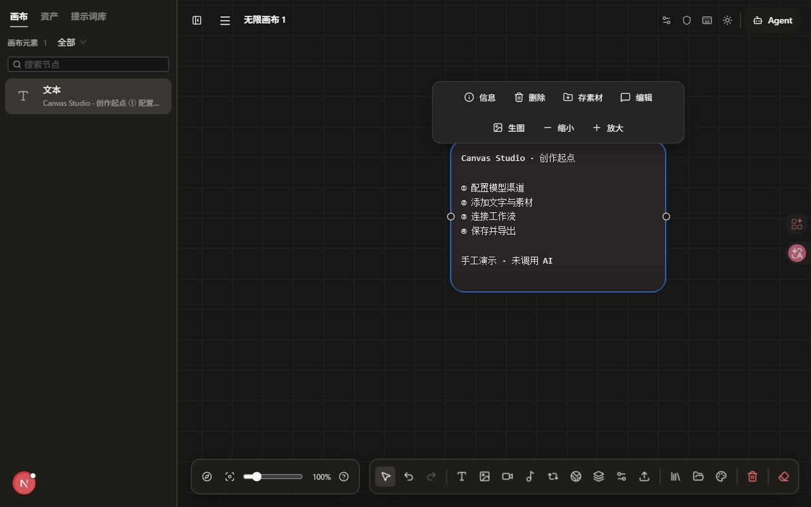
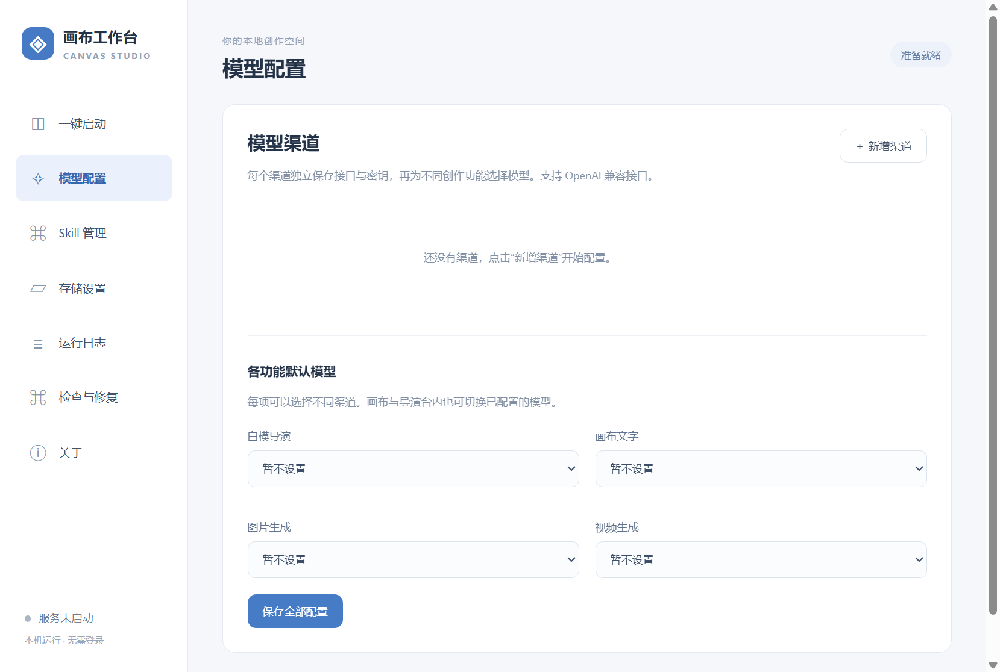

# Canvas Studio · 画布工作台

将无限画布、AI 图片与视频工作流、CozyClay 动态白模导演台整合为本机创作工作台。通过中文桌面启动器管理浏览器、模型渠道、素材和后台服务。

**[下载发行包](https://github.com/wenpengx/canvas-studio/releases/latest)** · **[桌面使用指南](docs/overview/desktop-guide.md)** · [项目全貌与当前状态](docs/overview/project-status.md) · [文档目录](docs/index.md)

## 下载哪个包

| 电脑 / 用途 | Release 附件 |
| --- | --- |
| Windows 10/11，Intel / AMD 64 位 | `CanvasStudio-Windows-x64-版本.zip` |
| Mac，Apple M 系列芯片 | `CanvasStudio-macOS-arm64-版本.zip` |
| Mac，Intel 处理器 | `CanvasStudio-macOS-x64-版本.zip` |
| 阅读、修改或自行构建 | `CanvasStudio-Source-版本.zip` |

每个 ZIP 均附 `.sha256` 校验文件。桌面整合包包含所需运行环境，普通用户不需要安装 Node、Go 或 FFmpeg；仍需安装浏览器，并自行配置 AI 服务接口、密钥和额度。源码 ZIP 不能直接当作桌面应用运行。

macOS 包为临时签名，尚无 Apple Developer ID 签名及公证；首次打开和手动更新方式见[使用指南](docs/overview/desktop-guide.md)。构建成功与服务启动检查通过，不代表所有硬件、钥匙串、浏览器和真实模型均已完成实机验收。

## 四步开始

1. 从 [Releases](https://github.com/wenpengx/canvas-studio/releases) 下载对应系统与架构的完整 ZIP，校验后解压。
2. Windows 打开 `画布工作台启动器.exe`；Mac 将 `画布工作台启动器.app` 放入“应用程序”后打开。
3. 选择浏览器，在“模型配置”添加渠道、API Key 和模型，分别选择文字、图片、视频与白模导演的默认模型。
4. 点击“一键启动工作台”，新建画布并添加节点。白模导演需支持工具调用的模型；图片参考还需要视觉能力。

详细说明包括[模型配置、画布操作、保存备份、更新和故障排查](docs/overview/desktop-guide.md)。连接测试不提交生成任务；真正生成可能消耗所配置服务的额度。

## 能做什么

- **画布与工作流**：文字、图片、视频、音频、提示词、素材、节点连接、批量处理、生成历史与导出。
- **动态白模导演台**：CozyClay 场景、角色、道具、动作、机位与镜头编辑，截图和 MP4 回传画布。
- **统一模型渠道**：独立接口和加密密钥，按功能选择渠道与模型，画布与导演台共用配置。
- **文件夹循环**：逐文件运行相连工作流，独立保存结果，支持暂停、继续和错误定位。
- **Skill 与 MCP**：管理自己的 Skill；画布和导演台提供 stdio / HTTP MCP 接入。
- **本机管理**：专用浏览器资料、数据目录、服务进程、日志和更新；Windows 支持在线安装与离线导入，Mac 校验下载后手动替换应用。

功能范围、技术栈、模块关系和未验收项目见[项目全貌](docs/overview/project-status.md)，具体操作见[节点手册](docs/canvas/canvas-node-manual.md)与[快捷键](docs/canvas/canvas-shortcuts.md)。

## 界面预览

以下为本仓库运行界面的实际截图，演示数据不代表 AI 生成质量。截图的运行模式与来源见[截图说明](docs/overview/screenshots.md)。

## 数据与开发

Windows 桌面版默认使用整合包内 `data/`；Mac 默认使用 `~/Library/Application Support/Canvas Studio/data`。两者都可在启动器中选择数据目录。跨设备或系统用户迁移后需重新输入密钥。源码 Web 模式的未登录项目保存在浏览器本地，不能与桌面本机服务模式混为一谈。

| 想了解什么 | 文档 |
| --- | --- |
| 从下载安装到使用、保存与更新 | [桌面使用指南](docs/overview/desktop-guide.md) |
| 整体功能、架构、依赖、现状与限制 | [项目全貌](docs/overview/project-status.md) |
| 自行编译 Windows / Mac、源码与发行流程 | [桌面构建](docs/desktop-build.md) |
| 源码启动与 Docker 入口 | [快速开始](docs/overview/quick-start.md) |
| 已实现但还需人工确认 | [待测试](docs/progress/pending-test.md) |
| 后续工作 | [TODO](docs/progress/todo.md) |

## 来源与许可

基于 [tigerowo/infinite-canvas](https://github.com/tigerowo/infinite-canvas) 与 [NomaDamas/CozyClay](https://github.com/NomaDamas/CozyClay) 改造整合，原作者版权及许可保留。整合修改按 [AGPL-3.0](LICENSE) 分发；第三方代码、模型、素材与依赖沿用各自许可，见[开源说明](launcher/SOURCE-NOTICE.txt)与[CozyClay 许可](integrations/cozyclay/LICENSING.md)。

