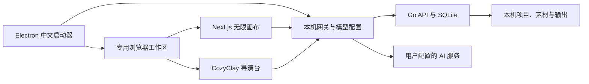

# 项目结构与当前状态

Canvas Studio 是无限画布与 CozyClay 的桌面整合工作台。桌面启动器负责本机服务、模型配置、浏览器资料与数据目录；浏览器工作区负责画布和 3D 创作。它同时保留源码 Web 版的前后端结构，使用前应先区分这两种运行方式。

版本号以根目录 [`VERSION`](../../VERSION) 和 [`launcher/package.json`](../../launcher/package.json) 为准；可下载平台、文件与验收说明以 [Releases](https://github.com/wenpengx/canvas-studio/releases) 为准。

## 运行方式

| 方式 | 适用对象 | 配置与数据 |
| --- | --- | --- |
| 桌面整合包 | 直接使用画布和导演台的个人用户 | 启动器管理本机服务、SQLite、磁盘素材、独立浏览器资料和系统加密的模型密钥，无需软件账号 |
| 源码 Web 服务 | 修改、部署或集成前后端的开发者 | Go API 与 Next.js 页面；未登录浏览器本地保存，账号同步取决于部署配置；本地直连密钥保存在浏览器中 |

桌面包不需要使用者安装 Node、Go 或 Docker，但仍需支持的浏览器。在线 AI 由用户配置的服务商提供；包内不包含外部 AI 模型权重和免费额度。

## 模块与调用关系

网关监听回环地址。桌面模式浏览器通过本机网关调用模型，真实 API Key 由启动器配置读取后转发。画布与导演台通过适配层交换场景、截图、视频及项目资源。

| 路径 | 职责 |
| --- | --- |
| `launcher/` | Electron 启动器、渠道设置、浏览器启动、进程管理、更新、文件夹授权、MCP 桥及桌面打包 |
| `web/` | Next.js、React、TypeScript 画布和页面；画布私有代码位于 `web/src/app/(user)/canvas/` |
| `handler/`、`router/`、`middleware/` | API 入参、路由、认证及中间件 |
| `service/` | 业务逻辑、生成任务、配置与素材处理 |
| `repository/`、`model/` | 数据库访问、表结构和业务数据类型 |
| `integrations/cozyclay/` | 固定版本的导演台源码、画布适配、动作／相机／场景及导演台 MCP |
| `canvas-agent/` | 保留的上游 Agent／桥接工具；桌面专属 MCP 另由 `launcher/` 提供 |
| `docs/` | 使用、开发、功能、待测试与待办文档 |
| `work/`、`outputs/` | 本地构建缓存、中间文件与成品；不作为用户数据发布 |

## 能力范围

下表描述代码和现有项目文档提供的能力，不把某次界面截图或 CI 构建等同于所有系统、模型和流程的实机验收。

| 方向 | 已有链路 | 仍需关注 |
| --- | --- | --- |
| 画布 | 多项目、节点和连线、撤销重做、素材、历史、导入导出、图像及视频等生成入口 | 外部模型接口与媒体能力随服务商变化 |
| 导演台 | 场景、对象、骨骼角色、镜头、动作、截图／MP4 回传、完整项目保存 | 复杂动作需要人工调整；GPU、编解码与实机体验需分别确认 |
| 模型渠道 | 多渠道、独立密钥、模型分类、文字／图片／视频／导演台默认选择、任务按原渠道查询 | 支持工具调用与视觉输入的模型须由服务商实际提供 |
| 文件夹循环 | 原生选目录、自然排序、逐文件执行、独立结果、暂停与手动恢复 | 不支持嵌套循环、导演台或组的自动执行；状态不明时停止而不自动重发 |
| Skill | 本机管理、Markdown／文本导入导出、文字生成引用 | Skill 是模型指令，不是本机脚本运行器 |
| MCP | 画布和导演台独立 stdio／HTTP 入口、显式目标工作区 | 不同客户端配置和多工作区操作需核对实际连接 |
| 视频附件 | 本机 FFmpeg 解码与九宫格抽帧，发送时交给视觉模型 | 原始问题文件、编码差异和服务商视觉能力需验证 |
| 桌面分发 | Windows x64、macOS ARM64／x64 独立打包路径和对应源码 | 以 Release 附件是否实际生成、下载及校验成功为准 |
| 更新与修复 | 正式版本目录、文件摘要与清单校验、离线完整包、版本选择 | 系统代理、安装／回退、数据兼容性与平台更新方式需实机确认 |

Windows 整合版原有文档记录了 Linux 构建、后端／启动器测试和浏览器联调，也明确保留 Windows 系统加密、真实 API、实际更新／回退等待验收项。本仓库新增的文档、截图和跨平台构建工作不会自动把这些项目改成“已通过”。最新范围查看 [待测试](../progress/pending-test.md)，后续工作查看 [TODO](../progress/todo.md)。

## 技术与依赖

| 层次 | 主要依赖 | 版本来源 |
| --- | --- | --- |
| 桌面程序 | Electron、`@electron/packager`、`http-proxy`、`semver`、ZIP 归档／解压工具 | `launcher/package.json` 和锁文件 |
| 画布前端 | Next.js、React、TypeScript、Ant Design、Tailwind、Zustand、localforage、Mediabunny | `web/package.json` 和锁文件 |
| 后端 | Go、Gin、GORM、SQLite；源码服务另含 MySQL／PostgreSQL 驱动 | `go.mod`、`go.sum` |
| 导演台 | CozyClay、Three.js、React Three Fiber／Drei、Vite、Mediabunny、Agent／MCP 组件 | `integrations/cozyclay/package.json` 和锁文件 |
| 视频运行环境 | FFmpeg 及其发行许可／构建说明 | `launcher/scripts/media-runtime.mjs` 与整合包内 notices |

完整版本和传递依赖应读取对应锁文件，不用本表替代可复现依赖清单。开发环境和最终用户运行环境也不同：开发构建需要 Node／npm／Go，发行包随附所需运行时。

## 发行文件与数据边界

桌面 ZIP 包含启动器、前端和导演台构建产物、Go 服务、Node、媒体运行组件、使用说明、对应源码和校验清单；源码 ZIP 提供代码与构建材料，不包含已安装依赖、完整开发缓存或用户数据。

用户的项目、素材、日志、模型配置和浏览器资料属于数据目录，不应加入公开源码或发行包。备份方式、首次打开与故障排查见 [桌面使用指南](desktop-guide.md)，构建和平台细节见 [桌面发行构建](../desktop-build.md)。

Docker 相关文件仍保留，静态资源路径和完整生产部署继续属于项目待办；不能由桌面整合版可打包推断 Docker 生产环境已经验证。

## 来源与许可

本项目基于 [tigerowo/infinite-canvas](https://github.com/tigerowo/infinite-canvas) 和 [NomaDamas/CozyClay](https://github.com/NomaDamas/CozyClay) 整合。仓库的独立 Git 提交历史不改变原作者版权、第三方素材或开源许可。

- 整合修改按仓库 [LICENSE](../../LICENSE) 中的 AGPL-3.0 分发。
- 固定上游提交与整合说明见 [SOURCE-NOTICE](../../launcher/SOURCE-NOTICE.txt)。
- CozyClay 的许可与第三方资产说明见 [LICENSING](../../integrations/cozyclay/LICENSING.md) 和 [THIRD_PARTY_NOTICES](../../integrations/cozyclay/THIRD_PARTY_NOTICES.md)。
- Electron、Node、FFmpeg 及依赖各自的许可随组件保留；发行时应同时提供对应源码及构建材料。

本页用于描述项目和材料位置；具体许可条件以仓库与第三方组件的原始许可文本为准。
