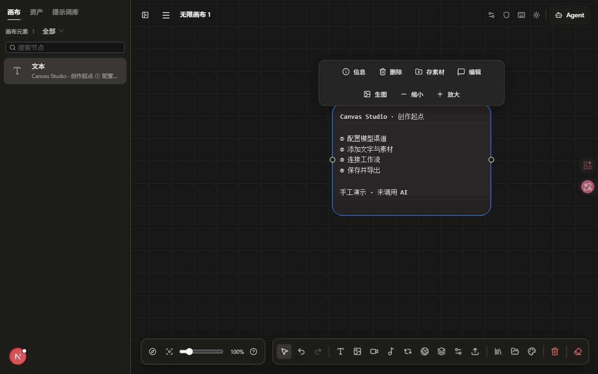
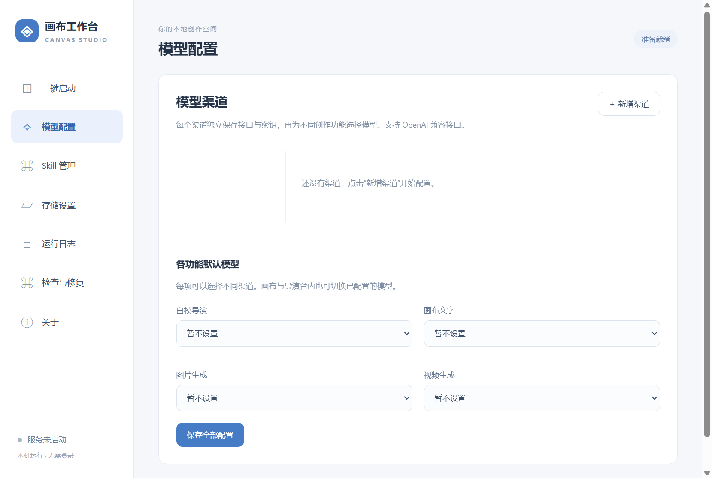
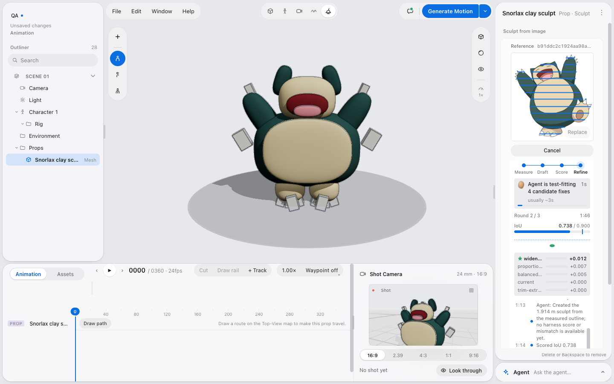

# 界面截图说明

本页图片用于帮助理解操作入口，不是模型结果质量或全部功能验收报告。

## 桌面启动器

使用本仓库实际 Electron 启动器，在独立演示数据目录启动后，由 Electron 的页面捕获接口导出。图片中的“服务未启动”是拍摄时的真实状态；没有使用示意网页替代启动器，也没有配置真实密钥。

## 画布编辑器

从本仓库源码启动前端，在独立的本机演示画布中实拍。截图按实际 1280×800 页面视口裁切，去除导出工具附加的黑色填充；没有修改界面内容。演示内容为手工输入，未调用付费模型。源码 Web 模式的存储与桌面服务模式的区别见[项目全貌](project-status.md)。

## 模型配置

从实际 Electron 启动器切换到模型配置页后，由页面捕获接口导出。展示配置入口与字段；没有公开 API Key，不表示已经配置任何服务商或取得模型额度。

## 导演台

上图为仓库自带的 CozyClay 上游真实界面示例，保留原界面与角色。它用于展示导演台编辑器的大致结构，不是本轮整合版实拍或模型效果验收。来源文件为 `integrations/cozyclay/docs/images/sculpt-mode-live.png`，许可说明见[CozyClay 文档](../../integrations/cozyclay/LICENSING.md)。
